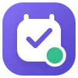

# Promemoria personali per Chrome

 <strong>La tua agenda personale, direttamente in Chrome.</strong>

Dashboard per attività e notifiche, con tema scuro, promemoria ricorrenti e importazione di eventi da calendari `.ics`. Nessun account o server: i dati restano nel profilo Chrome locale.

## Funzionalità

- Dashboard responsive, con sezioni per tutte le attività, oggi, prossime e completate.
- Popup per aggiunta rapida e dashboard completa per modificare e organizzare.
- Categorie, priorità, ricerca, filtri e ordinamento.
- Tema chiaro/scuro condiviso tra popup e dashboard.
- Promemoria singoli e ricorrenti ogni giorno, con notifiche desktop.
- Importazione di eventi futuri da file iCalendar `.ics` esportati da Google Calendar, Apple Calendar o Outlook.
- Rilevamento dei duplicati durante le reimportazioni e aggiornamento degli eventi già importati.
- Eliminazione sicura delle attività completate o di tutti i promemoria.
- Nessun accesso a pagine web, account o servizi remoti.

## Installazione

1. Scarica la repository (**Code → Download ZIP**) ed estrai lo ZIP, oppure clonala con Git.
2. Apri `chrome://extensions` in Google Chrome e attiva **Modalità sviluppatore**.
3. Seleziona **Carica estensione non pacchettizzata** e scegli la cartella che contiene `manifest.json`.
4. Fissa l'estensione dalla barra degli strumenti, quindi apri il popup o la dashboard.
5. Consenti le notifiche di Chrome e del sistema operativo.

## Importare eventi dal calendario

L'estensione importa file `.ics` localmente, senza chiedere la password del calendario e senza inviare il file a un server.

1. Esporta o scarica il calendario in formato iCalendar (`.ics`) dal servizio che usi. In Google Calendar, usa **Impostazioni → Importazione ed esportazione → Esporta**; puoi anche esportare un singolo calendario dalle sue impostazioni.
2. Nella dashboard, fai clic su **Importa file .ics** e seleziona il file.
3. Gli eventi futuri con data di inizio diventano promemoria locali; l'orario dell'evento viene usato come orario della notifica. Gli eventi tutto il giorno sono impostati alle 09:00 locali.
4. Importa di nuovo il file dopo aver aggiornato il calendario: gli eventi con lo stesso identificativo vengono aggiornati anziché duplicati.

**Nota:** l'importazione `.ics` è uno snapshot, non una sincronizzazione live. Le modifiche successive nel calendario non si riflettono automaticamente: occorre esportare e importare nuovamente. Le ricorrenze vengono importate come sono rappresentate nel file; non vengono espanse automaticamente da regole `RRULE` non materializzate in occorrenze. L'eliminazione o il completamento di un promemoria importato non modifica l'evento originale nel calendario.

## Promemoria ricorrenti

Nel campo **Ripetizione**, seleziona **Ogni giorno**. Dopo una notifica, l'estensione pianifica la ricorrenza per il giorno successivo mantenendo l'orario locale. Per interromperla, modifica l'attività e scegli **Una volta**, oppure completala/eliminala.

## Privacy e limiti

- Dati e preferenza del tema sono salvati con `chrome.storage.local` nel profilo Chrome.
- I file `.ics` vengono letti nel browser e non vengono caricati online.
- Chrome deve poter eseguire le notifiche; se viene chiuso completamente, una notifica potrebbe arrivare solo dopo la riapertura.
- Disinstallando l'estensione o cancellandone i dati, le attività locali possono andare perse.
- Per applicare aggiornamenti del codice, vai su `chrome://extensions` e premi **Ricarica** sull'estensione.

## Sviluppo

L'estensione usa Manifest V3 e API Chrome (`storage`, `alarms`, `notifications`). Non richiede build o dipendenze esterne.

## Licenza

Non è ancora stata scelta una licenza per il riutilizzo del codice.
